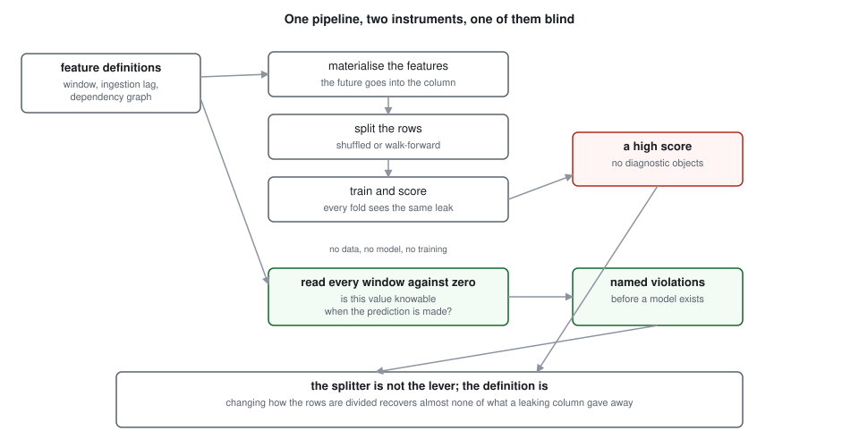
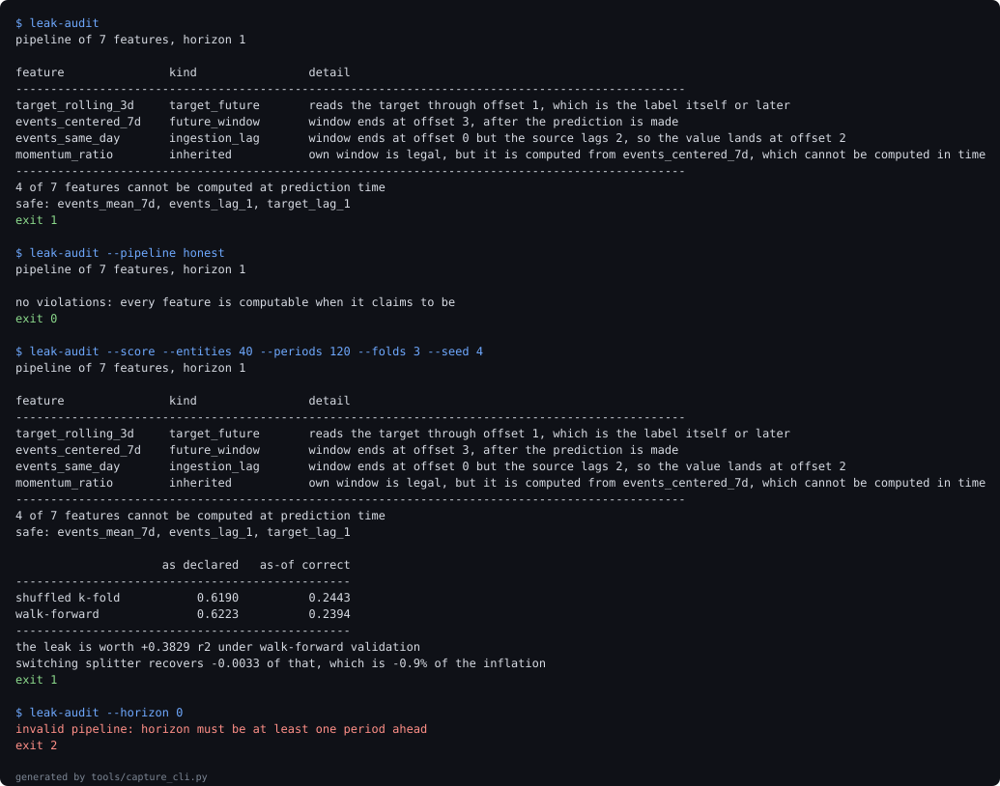

# temporal-leakage-audit

**Finds feature definitions that cannot be computed at prediction time by reading the pipeline, because no score can find them and changing the validation splitter does not help.**

[](https://github.com/jayanthkodamachili/temporal-leakage-audit/actions/workflows/ci.yml)


## What a backtest cannot tell you

A cross-validated score cannot expose a leaking feature pipeline, because the leak lifts every fold together. The training rows carry their own future and so do the validation rows, so comparing them reveals nothing. The score goes up and every diagnostic stays quiet.

The part that surprises people is that switching to a time-ordered splitter does not help either. The leak is in the feature's definition, not in how the rows were divided, and no arrangement of rows repairs a column that was built from the future.

Four questions this answers that a score structurally cannot:

1. Whether each feature's aggregation window closes before the moment the prediction is made.
2. Whether the data it reads has actually landed by then, which is a different question with a different answer.
3. Whether a feature with an impeccable window inherits a leak from something three joins upstream.
4. What the leak is worth, which turns out to depend on facts the audit cannot see.

## The numbers

- The example pipeline **reports 0.6598** r² under walk-forward validation. The same pipeline with every window clamped to what is knowable scores **actually 0.3267**. The leak is **worth +0.3330 r2**, so the model looks roughly twice as good as it is.
- **Changing the splitter recovers -0.0030**, which is **-0.009 of the inflation**. Shuffled k-fold and walk-forward agree almost exactly on a leaking pipeline. The standard advice addresses a different problem.
- **The uncomfortable one:** the audit finds **4 of 7 features** unusable, and three of those four are worth nothing. **target_rolling_3d accounts** for **+0.3226 on its own**; the **next worth +0.0001**. A severity-ranked violation list is not a priority list, and this repository publishes the ranking knowing that.

84 tests, 100 percent line coverage, and every figure above is re-measured by CI from the experiments rather than typed into this file. `tools/check_numbers.py` fails the build if any of them drifts.

## Quickstart

Requires Python `3.11` or newer. No credentials, no network at runtime.

```bash
pip install -e ".[dev]"

# the audit: no data, no model, about two seconds
leak-audit

# what the leak was worth, and how little the splitter recovers
leak-audit --score

# everything: lint, suite, re-measure all four experiments, check the prose
make verify
```

The first command needs no dataset, because the question it answers is a property of the definitions. That is what makes it runnable in a pre-commit hook on a pipeline that has no data behind it yet.

## The claim, one section at a time

### The splitter is not the lever

Mean r² over eight seeds, one panel per seed, the same model in every cell:

| splitter | pipeline as written | same, clamped to as-of | repaired pipeline |
| --- | --- | --- | --- |
| shuffled k-fold | 0.6568 | 0.3231 | 0.3228 |
| walk-forward | 0.6598 | 0.3267 | 0.3267 |

Read down the first column. Moving from shuffled to walk-forward, the fix every article recommends, changes the score by three thousandths. Read across the first row instead and the score halves.

The third column is the control. Repairing the definitions by hand gives the same number as clamping them automatically, which is what makes the clamped column a correction rather than a different feature set. The repaired pipeline **shows +0.0000 inflation**, as it should.

### Three of the four violations are worth nothing

Dropping one offending feature at a time, rescoring, and sorting by what the drop costs:

| feature dropped | kind | score without it | what it was worth |
| --- | --- | --- | --- |
| target_rolling_3d | target_future | 0.3347 | +0.3226 |
| momentum_ratio | inherited | 0.6572 | +0.0001 |
| events_same_day | ingestion_lag | 0.6574 | -0.0001 |
| events_centered_7d | future_window | 0.6584 | -0.0011 |

The **full pipeline scores 0.6573** and **falls to 0.3255** with every violation removed. One feature accounts for essentially all of it.

The reason is redundancy rather than severity. `events_centered_7d` leaks the future of the event series, and the honest trailing features already carry most of that signal, so removing it costs nothing. `target_rolling_3d` leaks the label itself, which nothing else carries. A leak is worth what it adds beyond the legitimate features, and the audit has no way to know that, because knowing it requires exactly the scoring the audit refuses to depend on.

That is a real limitation of the instrument and it is printed here rather than in a footnote.

### The same definitions are worth sixty times more at one horizon than another

| forecast horizon | target window reaches the label | as written | as-of | inflation |
| --- | --- | --- | --- | --- |
| 1 | yes | 0.6653 | 0.3409 | +0.3243 |
| 2 | no | 0.3396 | 0.3348 | +0.0049 |
| 3 | no | 0.3402 | 0.3318 | +0.0084 |
| 5 | no | 0.3313 | 0.3264 | +0.0049 |
| 7 | no | 0.3288 | 0.3216 | +0.0072 |

This experiment was written to test a guess that was wrong. The expectation was that a longer horizon makes the honest problem harder and so makes a leaking feature worth more. What happens instead is specific: `target_rolling_3d` reads the target over the window ending at offset +1, the label at horizon one sits at offset +1, and the window lands exactly on it. At horizon two the label has moved out of reach.

The target window reaches the label at **1 of 5 horizons**. Where it does, the leak is worth **+0.3243 at horizon one**; everywhere else **at most +0.0084 elsewhere**, a **ratio of 39** from byte-identical definitions.

The audit flags the feature at every horizon, correctly, because reading the target past the prediction moment is never legitimate. What it cannot do is tell you which horizon turns that into a disaster.

### Does the instrument work

Random pipelines with randomly injected problems, audited, compared against what was injected:

| features per pipeline | leaks found | recall |
| --- | --- | --- |
| 3 | 481 | 1.0000 |
| 6 | 978 | 1.0000 |
| 12 | 2049 | 1.0000 |
| 24 | 4087 | 1.0000 |

**Recall of 1.0000** and **precision of 1.0000** across **7595 injected leaks**, and of **400 pipelines with nothing** wrong, **0 were flagged**.

A perfect score deserves suspicion, so here is what it does and does not mean. The generator injects leaks by violating the same conditions the audit checks, so this demonstrates that the implementation has no bugs across thousands of randomly shaped pipelines, including inheritance through dependency edges. It demonstrates nothing about whether the rules are complete. A leak of a kind neither the generator nor the audit models is invisible to both, and this experiment would score it as a success.

## The bugs the measurement found

**An experiment designed around a wrong guess produced a better finding than the guess.** The horizon sweep was built expecting inflation to grow with the forecast horizon. It collapses instead, because what matters is whether the leaking window happens to overlap the label, not how hard the problem is. The experiment's docstring now opens with the wrong guess, because the mechanism is only legible next to the thing it replaced.

**A feature with its own violation was also being reported as inheriting one.** The first version walked ancestors for every feature, so a leaking feature built from another leaking feature produced two entries. A report that pads itself is a report people stop reading, and the rule is now one feature, one reason, pinned by a test.

**Cycle detection recursed and would have died on a real pipeline.** A feature graph can be deeper than the interpreter's recursion limit, and crashing is a poor way to report a cycle. It uses an explicit stack, and a separate test covers the diamond case, where two paths reach one ancestor and a naive traversal calls it a cycle.

## Architecture



Generated by `tools/render_diagram.py` and committed. CI regenerates it and fails if the committed copy has drifted.

## Evidence



A replay of real stdout, captured by `tools/capture_cli.py`. The first run is the whole argument: four violations named, with no dataset anywhere. Every command and the exit code it actually returned are in [docs/evidence-manifest.json](docs/evidence-manifest.json).

## The example pipeline

A **pipeline of 7 features** with four problems. Every one is a definition somebody would write on purpose, with a reason that sounds good at the time:

- `events_centered_7d` is a centred rolling mean, written to smooth a series without a phase shift. Correct for a chart, fatal for a feature.
- `events_same_day` reads today's value, which sits in the warehouse at training time and does not arrive for another two days at serving time. The window is legal and the data is not there.
- `target_rolling_3d` is a rolling outcome mean built from a dataframe that already held the label column. The most common way a label reaches a feature.
- `momentum_ratio` has an impeccable window of its own and is computed from the centred mean. This is the one that survives code review, because the definition in front of you is fine.

A catalogue of obviously broken definitions would prove nothing, because nobody ships those. `honest_pipeline` is the same seven ideas with each definition repaired, and it audits clean.

## What this cannot measure

Its own section, because these are the limits a reviewer should know before trusting anything above.

- **What a violation is worth.** Measured in experiment two and not inferable from the audit. Three of four violations there were worth nothing because legitimate features already carried the same signal. Ranking by severity is not ranking by consequence, and this tool offers the first while the decision needs the second.
- **Rule completeness.** Experiment four shows the implementation matches its rules perfectly, on leaks generated from those same rules. A leak of a kind the rules do not model passes silently. The rules cover windows, ingestion lag, target reads and inheritance, and that is not an argument that nothing else exists.
- **Whether the declared metadata is true.** The audit reads what a feature says about itself. A window declared as trailing and implemented as centred audits clean, because the implementation is not what is being read. This is the gap a reviewer should press on hardest.
- **Entity-level leakage.** Everything here is about time. The same row appearing in train and test through a duplicated key, or an identifier that encodes the outcome, is a different failure that this does not look for.
- **Synthetic panels only.** The mechanism is structural and transfers. The magnitudes are properties of a generator where the target depends on two lags of one series. No figure here should be quoted as a fact about a real forecast.
- **Declared, not observed:** that this panel's dependence structure resembles a production forecasting problem in any respect that matters.

See [ADR-005](docs/adr/ADR-005-what-this-cannot-measure.md).

## Layout, exit codes and reproduction

```
src/leakage_audit/
  features.py    the spec, the graph, cycle and ancestor walks
  audit.py       the static analysis, the only module that touches no data
  catalog.py     the example pipeline and its repaired twin
  dataset.py     seeded panel, and the two materialisations of one spec
  evaluate.py    the four-cell comparison
  cli.py         audit by default, scoring behind a flag
experiments/     four experiments writing JSON to docs/experiments
tools/           metric collection, number checker, diagram, capture
docs/adr/        five decision records
```

| exit code | meaning |
| --- | --- |
| 0 | every feature is computable when it claims to be |
| 1 | at least one feature is not |
| 2 | the pipeline is malformed and could not be audited |
| 3 | the audit itself failed |

Codes 0 and 1 both mean the tool worked. A pre-commit hook wants exactly this shape: a finding is a failure, and a malformed pipeline is a different failure.

| target | what it does |
| --- | --- |
| `make lint` | ruff |
| `make test` | suite with a coverage floor |
| `make experiments` | re-runs all four, rewriting their JSON |
| `make figures` | regenerates the diagram and the captured session |
| `make receipts` | re-measures every figure, then checks the prose |
| `make verify` | lint, test, receipts |

The number checker matches anchor phrases rather than bare digits, in both directions. Change any figure in this README, run `python tools/check_numbers.py`, and watch it fail.

## Stack

| technology | role | why here |
| --- | --- | --- |
| no dependencies in the audit | the static analysis | the claim is that this runs with no data and no model, so the module that makes it imports neither |
| scikit-learn | the four-cell comparison | the scoring exists to show what the audit saves you from, and uses the estimator a forecasting team would reach for |
| numpy | the panel and the windows | materialising one spec two ways is array slicing and belongs in the open |
| pytest with a coverage floor | the suite | a test asserts the audit never generates data, so the architectural claim fails the build if it breaks |
| ruff | lint and import order | one tool, one CI step |
| plain SVG, hand written | the diagram | a committed file renders the same in both themes |

## Decision records

1. [ADR-001: the audit reads definitions and never touches data](docs/adr/ADR-001-static-audit.md)
2. [ADR-002: dangling dependencies are reported, not raised](docs/adr/ADR-002-report-dont-raise.md)
3. [ADR-003: one feature, one reason](docs/adr/ADR-003-one-reason-per-feature.md)
4. [ADR-004: a committed SVG rather than a Mermaid fence](docs/adr/ADR-004-committed-svg.md)
5. [ADR-005: what this repository deliberately cannot measure](docs/adr/ADR-005-what-this-cannot-measure.md)

## The Pivot

Checking that a feature's implementation matches its declared window is deliberately out of scope. The audit reads metadata and trusts it.

The trigger is specific: the moment anyone treats a clean audit as proof the pipeline is correct. At that point the gap between declaration and implementation is the whole risk, and closing it means parsing the transformation code or diffing a recomputed column against the stored one, which is a different tool.

Future work, in order:

- Reconciling declared windows against the SQL or dataframe code that implements them.
- Weighting violations by what they are worth, which experiment two shows is the number people actually need.
- Entity-level leakage, where the time axis is fine and the keys are not.
- Reading real feature store metadata, so the audit runs against a pipeline nobody wrote for it.
- First metric to watch on any of these: whether recall on injected leaks stays at one when the generator stops sharing its rules with the audit.


